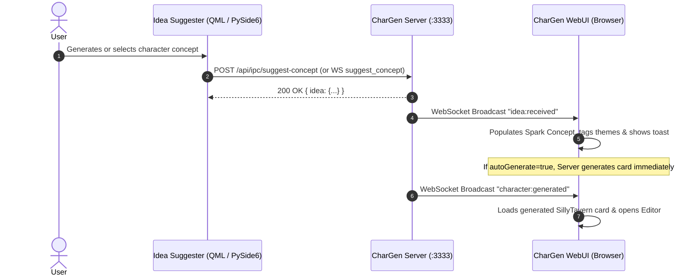

# ⚡ CharGenUI Server-Side IPC & Bridge API Specification

This document defines the **Inter-Process Communication (IPC)** architecture for connecting external companion apps (such as the **Idea Suggester QML App**, PySide6 desktop studios, or local AI pipelines) directly into **CharGenUI**.

CharGenUI provides a dual-protocol IPC bridge running entirely server-side on **Bun**:
1. **Full-Duplex Real-Time WebSocket**: `ws://localhost:3333/api/ipc/ws` (and `ws://localhost:3333/ws`)
2. **Standard HTTP REST API**: `http://localhost:3333/api/ipc/*`

Both protocols enable external apps to submit character premises, query the currently active character card, synchronize relationship themes, and optionally trigger automatic character generation.

---

## 🏛 Architecture Overview



---

## 🌐 1. WebSocket Protocol (`ws://localhost:3333/api/ipc/ws`)

The WebSocket endpoint provides real-time, low-latency, bidirectional event synchronization between all connected clients (WebUI, QML apps, CLI agents).

### Connection Handshake
Upon establishing a WebSocket connection, CharGenUI automatically registers the client and emits a welcome payload containing the current server state, active card, and preset themes catalog:

```json
{
  "type": "ipc:connected",
  "payload": {
    "server": "CharGenUI IPC Server",
    "version": "2.5.0",
    "activeIdea": null,
    "activeCharacterName": "Valeria",
    "themes": [
      "Dominant / Submissive",
      "Master / Servant",
      "Domestic Discipline & Brat Taming",
      "Psychological Thriller",
      "Slow Burn",
      "..."
    ]
  },
  "timestamp": "2026-10-28T09:40:00.000Z"
}
```

---

### Client Messages (Actions sent from QML to Server)

Every client message is sent as a JSON string with an `action` and an optional `payload`.

#### 1. `suggest_concept` (Submit a character idea)
Pushes a newly generated or selected character concept into CharGenUI.

```json
{
  "action": "suggest_concept",
  "payload": {
    "concept": "Dr. Genevieve, an aloof deep-sea geneticist working in an underwater research station.",
    "archetype": "Kuudere Geneticist",
    "themes": ["Psychological Thriller", "Kuudere / Cold Analytical"],
    "suggestedBy": "Idea Suggester QML App",
    "autoGenerate": false
  }
}
```

*Fields*:
- `concept` *(string, required)*: The character premise, backstory seed, or prompt.
- `archetype` *(string, optional)*: Archetype title or role name.
- `themes` *(string[], optional)*: List of tropes or relationship dynamics to pre-select.
- `suggestedBy` *(string, optional)*: Origin identifier (defaults to `"Idea Suggester QML App"`).
- `autoGenerate` *(boolean, optional)*: When `true`, instructs CharGenUI to immediately run character card generation and broadcast `character:generated`.

**Server Response (to sender)**:
```json
{
  "type": "idea:submitted",
  "payload": {
    "idea": {
      "id": "idea_1793180610130_wbyqs",
      "concept": "Dr. Genevieve...",
      "archetype": "Kuudere Geneticist",
      "themes": ["Psychological Thriller", "Kuudere / Cold Analytical"],
      "suggestedBy": "Idea Suggester QML App",
      "timestamp": "2026-10-28T09:43:30.130Z",
      "autoGenerate": false
    }
  },
  "timestamp": "2026-10-28T09:43:30.131Z"
}
```

**Server Broadcast (to all connected clients including WebUI)**:
```json
{
  "type": "idea:received",
  "payload": {
    "idea": {
      "id": "idea_1793180610130_wbyqs",
      "concept": "Dr. Genevieve...",
      "archetype": "Kuudere Geneticist",
      "themes": ["Psychological Thriller", "Kuudere / Cold Analytical"],
      "suggestedBy": "Idea Suggester QML App",
      "timestamp": "2026-10-28T09:43:30.130Z"
    }
  },
  "timestamp": "2026-10-28T09:43:30.131Z"
}
```

---

#### 2. `get_active_card` (Query currently active character card)
Requests the full SillyTavern character card currently loaded in the workspace.

```json
{
  "action": "get_active_card"
}
```

**Server Response**:
```json
{
  "type": "card:active",
  "payload": {
    "character": {
      "id": "char_1793123456",
      "name": "Valeria",
      "description": "...",
      "personality": "...",
      "scenario": "...",
      "first_mes": "...",
      "tags": ["sci-fi", "kuudere"]
    }
  },
  "timestamp": "2026-10-28T09:45:00.000Z"
}
```

---

#### 3. `set_active_card` (Update active character card remotely)
Updates the active character card on the server and broadcasts the update to all connected interfaces.

```json
{
  "action": "set_active_card",
  "payload": {
    "character": {
      "name": "Astrid",
      "description": "A fierce shield-maiden...",
      "personality": "Defiant and proud."
    }
  }
}
```

---

#### 4. `get_themes` (Retrieve preset theme catalog)
```json
{
  "action": "get_themes"
}
```

**Server Response**:
```json
{
  "type": "themes:list",
  "payload": {
    "themes": [
      "Dominant / Submissive",
      "Master / Servant",
      "Captor / Captive",
      "Domestic Discipline & Brat Taming",
      "Sensory Deprivation",
      "..."
    ]
  },
  "timestamp": "2026-10-28T09:46:00.000Z"
}
```

---

#### 5. `ping` (Heartbeat)
```json
{ "action": "ping" }
```
**Server Response**:
```json
{ "type": "pong", "payload": { "time": 1793180610130 }, "timestamp": "..." }
```

---

## 📡 2. HTTP REST Endpoints (`http://localhost:3333/api/ipc/*`)

All REST endpoints support CORS (`Access-Control-Allow-Origin: *`) and return JSON.

### 1. `GET /api/ipc/status`
Returns server status, connected client count, and active card metadata.

**Response**:
```json
{
  "status": "online",
  "server": "CharGenUI IPC Server",
  "connectedClients": 2,
  "activeIdea": { "id": "...", "concept": "..." },
  "activeCharacterName": "Valeria",
  "availableThemesCount": 24,
  "timestamp": "2026-10-28T09:47:00.000Z"
}
```

---

### 2. `POST /api/ipc/suggest-concept` (alias: `/api/ipc/idea`)
Submits a concept via HTTP. Immediately broadcasts `idea:received` to the WebUI.

**Request**:
```http
POST /api/ipc/suggest-concept HTTP/1.1
Host: localhost:3333
Content-Type: application/json

{
  "concept": "Julianna, an overworked corporate director craving total surrender under rope suspension.",
  "archetype": "Julianna (Executive Surrender)",
  "themes": ["Sensory Deprivation", "Slow Burn"],
  "suggestedBy": "Idea Suggester QML App",
  "autoGenerate": false
}
```

**Response (200 OK)**:
```json
{
  "idea": {
    "id": "idea_1793180727567_n2q52",
    "concept": "Julianna, an overworked corporate director...",
    "archetype": "Julianna (Executive Surrender)",
    "themes": ["Sensory Deprivation", "Slow Burn"],
    "suggestedBy": "Idea Suggester QML App",
    "timestamp": "2026-10-28T09:48:00.000Z",
    "autoGenerate": false
  }
}
```

---

### 3. `GET /api/ipc/last-idea`
Returns the most recently submitted character concept.

**Response**:
```json
{
  "idea": {
    "id": "idea_1793180727567_n2q52",
    "concept": "...",
    "archetype": "...",
    "themes": ["..."]
  }
}
```

---

### 4. `GET /api/ipc/ideas`
Returns the 50 most recent submitted ideas (in reverse chronological order).

**Response**:
```json
{
  "ideas": [
    { "id": "...", "concept": "...", "timestamp": "..." },
    { "id": "...", "concept": "...", "timestamp": "..." }
  ]
}
```

---

### 5. `GET /api/ipc/active-card`
Returns the currently active character card loaded in CharGenUI.

**Response**:
```json
{
  "character": {
    "name": "Julianna",
    "description": "...",
    "personality": "...",
    "tags": ["romance", "power-exchange"]
  }
}
```

---

### 6. `POST /api/ipc/active-card`
Updates the active character card on the server and broadcasts `character:changed`.

**Request**:
```json
{
  "character": {
    "name": "Julianna",
    "description": "Updated character description..."
  }
}
```

---

### 7. `GET /api/ipc/themes`
Returns the full array of standardized roleplay tropes and themes.

**Response**:
```json
{
  "themes": [
    "Dominant / Submissive",
    "Master / Servant",
    "Captor / Captive",
    "Contractual Power Exchange",
    "Sensory Deprivation",
    "Degradation & Praise",
    "Femme Fatale",
    "Kuudere / Cold Analytical",
    "Tsundere / Defiant",
    "Yandere / Obsessive",
    "Gothic Aristocrat",
    "Rogue / Outlaw",
    "Slow Burn",
    "Enemies to Lovers",
    "Forbidden Attraction",
    "Dark Romance",
    "Unrequited Love",
    "Mutual Yearning",
    "Psychological Thriller",
    "Grimdark & Gritty",
    "Melancholic & Tragic",
    "Moral Ambiguity",
    "Wholesome & Cozy",
    "Dry Wit & Sarcasm"
  ]
}
```

---

## 💻 3. Ready-to-Use Client Code Examples

### Option A: Pure QML WebSocket Component

You can embed this directly into your QML application:

```qml
import QtQuick 2.15
import QtQuick.Controls 2.15
import QtWebSockets 1.15

Item {
    id: chargenBridge

    property string serverUrl: "ws://localhost:3333/api/ipc/ws"
    property bool isConnected: socket.status === WebSocket.Open
    property var activeCharacter: null

    signal ideaPushed(string ideaId)
    signal characterReceived(var character)

    WebSocket {
        id: socket
        url: chargenBridge.serverUrl
        active: true

        onStatusChanged: {
            if (socket.status === WebSocket.Open) {
                console.log("[QML IPC] Connected to CharGenUI WebSocket!");
            } else if (socket.status === WebSocket.Closed) {
                console.log("[QML IPC] Disconnected from CharGenUI. Reconnecting...");
                reconnectTimer.start();
            } else if (socket.status === WebSocket.Error) {
                console.warn("[QML IPC] WebSocket error:", socket.errorString);
            }
        }

        onTextMessageReceived: {
            try {
                var msg = JSON.parse(message);
                if (msg.type === "ipc:connected") {
                    console.log("[QML IPC] Registered with server:", msg.payload.server);
                } else if (msg.type === "idea:submitted") {
                    chargenBridge.ideaPushed(msg.payload.idea.id);
                } else if (msg.type === "character:generated" || msg.type === "card:active") {
                    chargenBridge.activeCharacter = msg.payload.character;
                    chargenBridge.characterReceived(msg.payload.character);
                }
            } catch (err) {
                console.warn("[QML IPC] JSON parse error:", err);
            }
        }
    }

    Timer {
        id: reconnectTimer
        interval: 3000
        repeat: false
        onTriggered: socket.active = true
    }

    // Public method: Push an idea to CharGenUI
    function pushIdea(conceptText, archetypeTitle, themesList, autoGenerate) {
        if (!isConnected) {
            console.warn("[QML IPC] Cannot push: WebSocket is not connected.");
            return false;
        }

        var payload = {
            action: "suggest_concept",
            payload: {
                concept: conceptText,
                archetype: archetypeTitle || "",
                themes: themesList || [],
                suggestedBy: "QML Idea Suggester",
                autoGenerate: !!autoGenerate
            }
        };

        socket.sendTextMessage(JSON.stringify(payload));
        return true;
    }

    // Public method: Query currently active card
    function requestActiveCard() {
        if (isConnected) {
            socket.sendTextMessage(JSON.stringify({ action: "get_active_card" }));
        }
    }
}
```

---

### Option B: Pure QML HTTP REST Client (`XMLHttpRequest`)

If your QML environment does not have `QtWebSockets`, use standard `XMLHttpRequest`:

```qml
function pushIdeaToCharGenUI(conceptText, archetypeTitle, themesList, autoGenerate, callback) {
    var xhr = new XMLHttpRequest();
    xhr.open("POST", "http://localhost:3333/api/ipc/suggest-concept");
    xhr.setRequestHeader("Content-Type", "application/json");

    xhr.onreadystatechange = function() {
        if (xhr.readyState === XMLHttpRequest.DONE) {
            if (xhr.status === 200) {
                var response = JSON.parse(xhr.responseText);
                console.log("[QML IPC] Idea successfully sent to CharGenUI! ID:", response.idea.id);
                if (callback) callback(true, response);
            } else {
                console.warn("[QML IPC] Failed to send idea, HTTP status:", xhr.status);
                if (callback) callback(false, xhr.statusText);
            }
        }
    };

    var payload = {
        concept: conceptText,
        archetype: archetypeTitle || "",
        themes: themesList || [],
        suggestedBy: "QML Idea Suggester",
        autoGenerate: !!autoGenerate
    };

    xhr.send(JSON.stringify(payload));
}
```

---

### Option C: Python / PySide6 Backend Slot

If your QML application uses a Python backend (`Backend(QObject)`), you can add this slot:

```python
import json
import threading
import urllib.request
from PySide6.QtCore import QObject, Slot, Signal

class Backend(QObject):
    ipcToast = Signal(str)

    @Slot(str, str, str, bool)
    def pushToCharGenUI(self, concept: str, archetype: str, themes_json: str, auto_generate: bool = False):
        """Pushes a character premise to CharGenUI over HTTP REST."""
        def _worker():
            try:
                themes = json.loads(themes_json) if themes_json else []
                payload = {
                    "concept": concept,
                    "archetype": archetype,
                    "themes": themes,
                    "suggestedBy": "Idea Suggester QML App",
                    "autoGenerate": auto_generate
                }

                url = "http://localhost:3333/api/ipc/suggest-concept"
                req = urllib.request.Request(
                    url,
                    data=json.dumps(payload, ensure_ascii=False).encode("utf-8"),
                    headers={"Content-Type": "application/json"}
                )

                with urllib.request.urlopen(req, timeout=5) as resp:
                    if resp.status == 200:
                        self.ipcToast.emit(f"⚡ Pushed '{archetype or 'concept'}' directly to CharGenUI!")
                    else:
                        self.ipcToast.emit(f"⚠️ CharGenUI responded with HTTP {resp.status}")
            except Exception as e:
                self.ipcToast.emit(f"⚠️ Could not reach CharGenUI on port 3333: {e}")

        threading.Thread(target=_worker, daemon=True).start()
```

---

## 🎯 Verification & Testing

You can verify the IPC connection at any time using simple terminal commands:

1. **Check Status**:
   ```bash
   curl -s http://localhost:3333/api/ipc/status | jq .
   ```

2. **Push a Test Idea**:
   ```bash
   curl -s -X POST http://localhost:3333/api/ipc/suggest-concept \
     -H "Content-Type: application/json" \
     -d '{
       "concept": "Seraphina, a fallen seraph running an underground speakeasy.",
       "archetype": "Fallen Seraph",
       "themes": ["Femme Fatale", "Slow Burn"],
       "suggestedBy": "CLI Test"
     }' | jq .
   ```

3. **Check the WebUI**:
   Open `http://localhost:3333` in any browser. You will see:
   - Header badge: `⚡ IPC Online`
   - Floating toast notification with the incoming idea.
   - The **Spark Concept** textarea automatically populated with the idea.
   - The corresponding theme pills highlighted in the UI.
